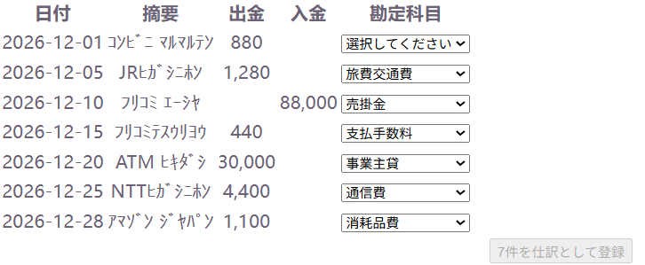

:::message
**この記事のポイント**

- 個人開発している複式簿記アプリに、銀行の入出金明細のCSVから仕訳を作る機能を追加しました
- 全体を通して、便利さよりも「**間違った仕訳を帳簿に入れないこと**」を優先して設計しています
- 銀行ごとに違う列名・日付・金額の書き方を、CSVの読み取りだけを受け持つモジュールで吸収しています
- 勘定科目はキーワードで推測しますが、推測できないものは空欄にして、最後は人が確認してから登録します
- 銀行のCSVには取引ごとの番号がないことが多いため、明細の内容から識別用のキーを作り、二重取り込みを3段階で防いでいます
- 形式の違う4つのサンプルCSVと、pytestのテスト（プロジェクト全体で54件）で動作を確かめています
:::

## はじめに

個人事業主向けの複式簿記アプリを個人開発しています。前回の記事では、貸借一致などの簿記のルールをコードで守る設計を紹介しました。

個人事業主の取引の多くは、事業用の銀行口座を通ります。売上の入金も、経費の支払いも、口座の明細を見ればほとんどわかります。ただ、それを1件ずつ仕訳として手で入力するのは手間がかかり、打ち間違いも起きます。そこで、銀行の入出金明細のCSVを読み込んで、まとめて仕訳にする機能を作りました。


*推測できなかった科目は空欄のまま。科目がすべて決まるまで、登録ボタンは押せません*

- デモ：https://ledger-frontend-5d86.onrender.com
  ※無料プランのため、最初の表示に1分ほどかかることがあります
- リポジトリ：https://github.com/ssei8643/ledger-api
- サンプルCSV：[samples/](https://github.com/ssei8643/ledger-api/tree/main/samples)（デモで読み込んで試せます）
- 構成：Python（FastAPI）／TypeScript（React）／SQLite（DB）

前回の記事はこちらです。

https://zenn.dev/burrata/articles/ssei-ledger-bookkeeping-rules

## 1. 全体の流れ：推測と登録を分ける

CSVを選んでから仕訳が登録されるまでの流れは、次のとおりです。

1. 画面でCSVファイルを選ぶ
2. ブラウザで文字コードを判定して、テキストにする
3. プレビューのAPIで、CSVを読み取り、勘定科目を推測し、取り込み済みかどうかを調べる
4. 画面で、人が勘定科目を確認・修正する
5. 登録のAPIで、もう一度チェックしてから仕訳を作る

推測と登録を2つのAPIに分けたのは、推測が外れることがあるからです。読み込んだ時点でいきなり登録してしまうと、推測が外れた仕訳がそのまま帳簿に入ります。

なお、プレビューの結果はサーバーには保存せず、登録のときに画面からまとめて送る形にしました。サーバーに保存すると、一時保存用のテーブルや有効期限の管理が必要になります。今回はその手間を省く代わりに、画面から送られてきた内容をそのまま信用せず、登録のAPIで勘定科目（未選択や「普通預金」の選択）と二重取り込みを改めてチェックし、借方・貸方もサーバー側で組み立てています（4〜6章）。

## 2. 銀行ごとの形式の違いを吸収する

最初の実装は、「日付,摘要,出金,入金」という、自分で決めた形式のCSVしか読めませんでした。主要な銀行5行と会計ソフト5社が公開しているCSVの形式を調べてみると、列名も、日付や金額の書き方も、ばらばらでした。

- **日付の列名**：日付、取引日、勘定日
- **摘要の列名**：摘要、入出金内容、お取り扱い内容、備考、詳細1＋詳細2、摘要＋追加摘要
- **金額の列**：出金・入金の2列（出金金額(円)、お引出し、支払金額など）、または入出金(円)の1列でマイナスが出金
- **日付の形式**：2026-12-01、2026/12/01、20261201、2026.12.01、2026年12月1日
- **空の金額**：空欄、または「-」「−」
- **その他**：Shift_JIS、金額のカンマ、列名に付いた「（円）」、新しい順と古い順の両方

実際の口座のデータは使わずに、これらの形式を参考にして、架空のデータでサンプルCSVを4つ作り、すべて読めるかを確かめました。

| ファイル | 確かめたこと |
|---|---|
| sample1 | 取引日・入金・出金・備考の順、日付は `20261201`、摘要は半角カナ、新しい順、BOMつき |
| sample2 | 「入出金金額（円）」の1列で、マイナスが出金、金額にカンマ |
| sample3 | Shift_JIS、勘定日・摘要＋追加摘要・お引出し・お預入れ、日付は `2026年12月1日`、空の金額は「-」 |
| sample4 | 最初に自分で決めた形式、同じ日に同じ内容の明細が2件 |

### 列名は別名の一覧から探す

列名は、別名の一覧を用意して、見つかったものを使うようにしました。比べる前に、見出しの全角・半角をそろえ、「(円)」と空白を取り除いています。こうすると「出金金額（円）」も「出金金額」として扱えます。

```python:bank_csv.py
DATE_COLUMNS = ["日付", "取引日", "勘定日"]
DESCRIPTION_COLUMNS = ["摘要", "入出金内容", "お取り扱い内容", "詳細1", "備考"]
EXTRA_DESCRIPTION_COLUMNS = ["追加摘要", "詳細2"]  # 摘要のうしろにつなげる
OUT_COLUMNS = ["出金", "出金金額", "お引出し", "支払金額"]
IN_COLUMNS = ["入金", "入金金額", "お預入れ", "預入金額"]
SIGNED_COLUMNS = ["入出金", "入出金額", "入出金金額"]  # マイナスなら出金


def normalize_header(name: str) -> str:
    # 「出金金額（円）」→「出金金額」のように、全角をそろえて単位と空白を取る
    text = unicodedata.normalize("NFKC", name or "").replace(" ", "")
    return re.sub(r"\(円\)$", "", text)
```

`unicodedata.normalize("NFKC", ...)` は、全角の英数字や括弧を半角に、半角カナを全角にそろえる処理です。4章の科目の推測でも使っています。

### 日付と金額を読み取る

日付は、3つのパターンのどれかに完全に一致したものだけを受け付けます。`date()` は存在しない日付（13月など）だと `ValueError` になるので、そのまま「読み取れない日付」として扱えます。

```python:bank_csv.py
DATE_PATTERNS = [
    re.compile(r"(\d{4})[-/.](\d{1,2})[-/.](\d{1,2})"),  # 2026/12/1 など
    re.compile(r"(\d{4})年(\d{1,2})月(\d{1,2})日"),  # 2026年12月1日
    re.compile(r"(\d{4})(\d{2})(\d{2})"),  # 20261201
]


def parse_date(value: str) -> date:
    text = unicodedata.normalize("NFKC", value or "").strip()
    for pattern in DATE_PATTERNS:
        m = pattern.fullmatch(text)
        if m:
            year, month, day = (int(g) for g in m.groups())
            return date(year, month, day)
    raise ValueError(f"日付として読めません: {value}")


def parse_amount(value: str) -> int:
    # 「1,000」「1,000円」に対応し、空欄や「-」「−」は0として扱う
    text = unicodedata.normalize("NFKC", value or "").strip()
    text = text.replace(",", "").replace("円", "").replace("−", "-")
    if text in ("", "-"):
        return 0
    return int(text)
```

金額が2列の形式では、出金と入金のどちらか一方だけに金額が入っている行を受け付けます。1列の形式では、プラスなら入金、マイナスなら出金です。どちらでもない行は、行番号つきのエラーにして、画面に表示します。

また、新しい順のCSVでも古い順のCSVでも、読み取ったあとに日付の古い順に並べ直しています。プレビューの画面で、いつも同じ順番で確認できるようにするためです。

### 読み取りの処理を別のファイルに分ける

読み取りの処理は、`bank_csv.py` という別のファイルにまとめ、アプリの中では「日付・摘要・入金か出金か・金額」という共通の形で扱えるようにしました。このファイルはFastAPIにもデータベースにも依存しないので、CSVの文字列を渡すだけでテストできます。前回の記事で「バックエンドが main.py 1ファイル構成」を限界に挙げましたが、その解消に向けた一歩でもあります。

## 3. 文字コードを判定する

銀行のCSVは、Shift_JISで作られていることがあります。そこで、ブラウザでファイルを読むときに、まずUTF-8として読み、読めなければShift_JISとして読み直しています。

```tsx:BankImport.tsx
// 銀行のCSVはShift_JISのことが多いので、UTF-8で読めなければShift_JISで読み直す
function decodeCsv(buffer: ArrayBuffer): string {
  try {
    return new TextDecoder("utf-8", { fatal: true }).decode(buffer)
  } catch {
    return new TextDecoder("shift_jis").decode(buffer)
  }
}
```

ポイントは、UTF-8を先に、`fatal: true` で試すことです。Shift_JISの日本語をUTF-8として読もうとすると、ほとんどの場合は不正なバイトとしてエラーになります。一方、UTF-8の日本語をShift_JISとして読むと、エラーにならずに文字化けした文字列ができてしまうことがあります。そのため、エラーで判定できるUTF-8を先に試しています。

ファイルの先頭にBOMが付いている場合、`TextDecoder` が取り除いてくれます。APIを直接呼ばれたときのために、サーバー側でも先頭のBOMを取り除いています。

## 4. 科目の推測：外れるくらいなら、空欄にする

### 表記ゆれをそろえてから比べる

勘定科目は、摘要に含まれるキーワードから推測します。比べる前に、2章と同じNFKCで表記をそろえ、英字を大文字にしています。これで「ﾌﾘｺﾐ」は「フリコミ」に、「ＡＭＡＺＯＮ」や「Amazon」は「AMAZON」になります。

```python:main.py
def suggest_account(description: str, direction: str) -> str | None:
    # 半角カナ・全角英数字をそろえてから比較する（例：ﾌﾘｺﾐ → フリコミ）
    text = unicodedata.normalize("NFKC", description).upper()
    rules = OUT_RULES if direction == "out" else IN_RULES
    for keyword, account in rules:
        if keyword in text:
            return account
    return None
```

### サンプルで見つかった落とし穴

サンプルのCSVで試したところ、sample1の「ﾌﾘｺﾐﾃｽｳﾘﾖｳ」（振込手数料）の科目が推測されませんでした。

原因は2つありました。1つは、規則には漢字の「手数料」しか書いていなかったことです。もう1つは、銀行の明細の半角カナでは、小さい「ャ」「ョ」の代わりに大きい「ﾔ」「ﾖ」が使われることがある点です。振込の名義などに使える文字（全銀協の規定文字）には、半角カナの小さい文字が含まれていません。NFKCは半角カナを全角カナにするだけで、大きい「ヨ」を小さい「ョ」には直しません。そのため「ﾃｽｳﾘﾖｳ」は「テスウリヨウ」になり、「テスウリョウ」とは一致しないので、カナで規則を足すときは両方の書き方が必要でした。同じsample1の「ｱﾏｿﾞﾝ ｼﾞﾔﾊﾟﾝ」も、「ジャパン」ではなく「ジヤパン」です。

形式の違いと同じく、こうした書き方のくせも、実際の形に近いデータで試さないと気づけませんでした。

### 入金か出金かで規則を分ける

規則は、出金用と入金用に分けています。

```python:main.py
OUT_RULES = [
    ("手数料", "支払手数料"),
    ("テスウリヨウ", "支払手数料"),
    ("テスウリョウ", "支払手数料"),
    ("ドコモ", "通信費"),
    # ...（省略）
    ("ATM", "事業主貸"),
]
# 同じキーワードでも、入金か出金かで科目が変わる
IN_RULES = [
    ("フリコミ", "売掛金"),
    ("振込", "売掛金"),
    ("ATM", "事業主借"),
]
```

たとえば「ATM」は、出金なら事業用の口座から生活費を引き出したので「事業主貸」、入金なら私的なお金を事業用の口座に入れたので「事業主借」です。同じ言葉でも、お金がどちらに動いたかで仕訳が変わります。これはプログラムの工夫というより、複式簿記の考え方そのものです。方向を分けずに1つの規則で推測すると、こうした明細で推測を外し続けることになります。

なお、入金の「振込」を「売掛金」としているのは、請求書を出した時点で「売掛金／売上高」を記帳し、入金のときにその売掛金を消し込む流れを前提にしているためです。入金のときにはじめて売上を記帳する場合は、画面で「売上高」に選び直します。

出金の「ATM」を「事業主貸」としているのも同じで、事業用の現金は持たず、引き出したお金は生活費に使うという前提です。経費の支払いに使う現金として引き出した場合は、画面で科目を選び直します。

### 推測できないものは空欄にする

キーワードに当てはまらない明細は、無理に科目を埋めず、空欄のままにしています。サンプルでは、次のような明細が空欄になりました。

- **ｺﾝﾋﾞﾆ ﾏﾙﾏﾙﾃﾝ**：何を買ったかで、消耗品費にも会議費にもなる
- **カフェ 打ち合わせ**：会議費か、私的な支出かは本人にしかわからない
- **カード ｾﾌﾞﾝBK**：ATMでの引き出しと思われるが、「カード」はほかの取引にも出てくる言葉なので、キーワードだけでは決められない

会計では、外れた推測は推測しないことよりも悪い結果を招きます。空欄なら、利用者は必ず気づいて自分で判断します。一方、もっともらしい科目が入っていると、確認しないまま「登録」を押してしまうかもしれません。そうして間違った仕訳が帳簿に入ると、その後の試算表も財務諸表もすべてずれていきます。

前回の記事で書いた「間違ったデータを入れない」という考え方を、推測にも当てはめた形です。画面では、科目が空欄の明細が1件でも残っていると登録ボタンを押せないようにし、登録のAPIでも、科目が空の明細は422エラーにしています。

もちろん、推測で埋まった行も、確認されないまま登録されるおそれはあります。そのため、規則に入れるのは「ドコモなら通信費」のように、ほぼ迷わない組み合わせだけにしています。推測で埋めた科目を画面上で見分けられるようにすることは、今後の課題です。

### キーワードの規則を選んだ理由

科目の推測には、まずキーワードの規則を使いました。理由は次のとおりです。

- **結果がぶれない**：同じ明細なら、いつも同じ科目が推測されます
- **理由を説明できる**：「摘要に『ドコモ』が含まれるから通信費」と、なぜその科目になったのかを示せます
- **データが外に出ない**：銀行の明細を、外部のサービスに送らずに済みます
- **テストできて、費用もかからない**：期待する結果をそのままテストに書けて、外部APIの利用料もかかりません

一方で、規則だけでは「カード ｾﾌﾞﾝBK」のような明細は推測できません。AIを使った推測は、このあと追加する予定です（「今の限界と今後」で書きます）。

## 5. 二重取り込みを防ぐ

### 明細を見分けるキーを自分で作る

同じCSVを2回読み込んだり、期間が重なるCSVを読み込んだりすると、同じ明細が2回登録されてしまいます。防ぐには「この明細は前に取り込んだか」を判定する必要がありますが、銀行のCSVには取引ごとの番号が入っていないことが多くあります。

そこで、明細の内容から識別用のキーを作ることにしました。最初は「日付＋摘要＋入金か出金か＋金額」でキーを作っていました。ところが、同じ日に、同じ店で、同じ金額の買い物を2回することもあります。sample4にも、同じ日の「コピー用紙 1,100円」が2件あります。内容だけでキーを作ると、2件目が1件目の「重複」と判定されて、取り込めなくなってしまいます。

そのため、「同じファイルの中で、同じ内容の明細の何件目か」もキーに含めました。

```python:main.py
seen: dict[str, int] = {}
for r in rows:
    # 同じ内容の明細が同じファイルに複数あっても区別できるよう、
    # 出現回数を含めてキーを作る
    base = f"{r.entry_date}|{r.description}|{r.direction}|{r.amount}"
    seen[base] = seen.get(base, 0) + 1
    import_key = hashlib.sha256(f"{base}|{seen[base]}".encode()).hexdigest()
```

新しい順のCSVと古い順のCSVでは、同じ内容の明細のどちらが「1件目」になるかが入れ替わります。ただ、もともと内容がまったく同じ明細どうしなので、入れ替わっても結果は変わりません。

### 3段階で確認する

二重取り込みは、次の3段階で確認しています。

1. **プレビューのとき**：取り込み済みの明細に「取り込み済み」と表示し、登録の対象から外す
2. **登録の直前**：キーがすでに登録されていれば、409エラーにする
3. **データベース**：キーに一意制約を付けておく。2つのリクエストが同時に届いて、手順2の確認をすり抜けた場合も、ここで弾いて409エラーにする

また、1回の取り込みで作る仕訳は、すべて1つのトランザクションで保存しています。途中でエラーになったときに、一部の明細だけが登録された中途半端な状態にならないようにするためです。

## 6. 借方・貸方はサーバー側で組み立てる

画面から登録のAPIに送るのは、明細の内容（日付・摘要・入金か出金か・金額）と、選んだ勘定科目だけです。借方・貸方の組み立ては、サーバー側で行います。

```python:main.py
# 出金：費用など（借方）／普通預金（貸方）
# 入金：普通預金（借方）／売掛金など（貸方）
for d in payload.drafts:
    if d.direction == "out":
        lines = [
            JournalLine(account=d.account, side="debit", amount=d.amount),
            JournalLine(account=BANK_ACCOUNT, side="credit", amount=d.amount),
        ]
    else:
        lines = [
            JournalLine(account=BANK_ACCOUNT, side="debit", amount=d.amount),
            JournalLine(account=d.account, side="credit", amount=d.amount),
        ]
```

こうしておけば、画面から送られたデータによって貸借が崩れることはありません。なお、前回の記事で紹介した「保存の直前」の貸借チェックは、この経路でも働きます。

ただし、相手科目に「普通預金」を選ばれると、借方と貸方が同じ科目の、意味のない仕訳になってしまいます。そこで、登録のAPIでは相手科目に「普通預金」を選んだ明細を422エラーにし、画面の選択肢からも外しています。

## 7. テストで確かめる

CSVの取り込みに関わるテストは、次のとおりです。全体では54件あります。

```text
test_いろいろな日付の書き方を読み取れる  （表の5種類＋月日の0を省いた書き方）
test_列名や並び順が違うCSVも読み取れる
test_入出金が1列でマイナスが出金のCSVも読み取れる
test_金額の空欄やハイフンは0として扱い追加摘要はつなげる
test_読めない行は行番号つきのエラーになる
test_サンプルCSVはすべて読み取れて日付順に並ぶ  （4ファイル）
test_半角カナの振込手数料も支払手数料と推測され推測できないものは空欄のまま
test_ATMは入金なら事業主借と推測される
test_同じ日に同じ内容の明細が2件あっても別々の明細として扱われる
test_同じ明細は二重に取り込めない
test_取り込みが同時に届いても二重には登録されず409が返る
test_勘定科目が未選択の明細は取り込めない
test_相手科目に普通預金を選んだ明細は取り込めない
```

サンプルCSVのテストでは、画面と同じ「UTF-8で読めなければShift_JISで読み直す」手順をPythonで再現してから読み取っています。これで、sample3のようなShift_JISのファイルも、画面とほぼ同じ流れで確かめられます。

二重取り込みの3段階目（データベースの一意制約）は、2つのリクエストが同時に届いたときにしか働きません。そこで、登録直前の確認を monkeypatch で「まだ取り込まれていない」と判定させ、別のリクエストに先を越された状況を再現してテストしています。

## 今の限界と今後

- **AIによる推測がまだない**：今後は、次の3段階にする予定です。
  1. キーワードの規則で推測できるものは、規則を使う（正確で、費用がかからず、テストできる）
  2. 規則で推測できなかった明細だけをAIに推測させる（外部に送る明細も最小限になる）
  3. 最後は、すべての結果を人が確認してから登録する
- **対応していない形式がある**：見出しの前に口座番号などの行があるCSVや、時刻の入った日付には、まだ対応していません。
- **摘要の書き方が変わると、別の明細と判定される**：銀行側で摘要の表記が変わると、同じ取引でもキーが変わり、二重取り込みを防げません。
- **推測で埋めた科目が見分けにくい**：推測で入った科目と、人が選んだ科目が同じ見た目で表示されます。推測の行に印を付けて、確認を促したいと考えています。
- **キーワードの規則がコードに書かれている**：利用者が自分で規則を追加できる画面があると便利です。
- **銀行口座が1つだけ**：明細を取り込む口座の科目は「普通預金」に固定しています。複数の口座を使い分ける人には対応できていません。

## 生成AIの使い方

前回と同じく、設計の相談や実装にはClaude（生成AI）を使いました。AIが出したコードは、内容を理解して説明できる状態にし、自分で動かしてテストで確かめてから取り入れています。

対応する列名や日付の書き方は、自分で各銀行や会計ソフトの資料を調べて一覧にし、それをもとにサンプルCSVも自分で作りました。そのサンプルで試したことで、「ﾃｽｳﾘﾖｳ」のような、コードを読んでいるだけでは気づけない問題が見つかりました。科目の推測を「まず規則、規則で推測できないものだけAI、最後は人」という順番にすることも、会計の面から自分で決めました。

一方で、AIの指摘で気づけたこともあります。

- **CSVでも同じ科目が借方と貸方に並ぶ**：同じ勘定科目を借方と貸方の両方に使う仕訳をAPIで拒否するようにしたとき、CSVの取り込みで相手科目に「普通預金」を選ぶと同じ問題が起きることを指摘されました。自分では思いついていなかった点で、6章の対策につながりました。
- **同時に届いたリクエストのテスト**：「確認のあと、保存の前に、別のリクエストに先を越された」状況を monkeypatch で再現するテストの書き方を教わりました。めったに起きない状況を、確実に再現して確かめられる書き方です。7章の、二重取り込みの3段階目のテストに使っています。

## おわりに

CSVの取り込みは、外から来るデータを扱う機能です。今回の開発で、次の3つのことを学びました。

- **形式の違いは、データを集めないと見えない**：コードを書く前に形式を調べ、サンプルを作って試したことで、列名や日付の違いだけでなく、半角カナの書き方のくせまで見つかりました。
- **推測は控えめに**：会計では、外れた推測が帳簿全体に広がります。わからないものは空欄にして、人に判断してもらう方が安全です。
- **外から来たデータは、何度でも確かめる**：二重取り込みはプレビュー・登録の直前・データベースの3段階で、科目の未選択や「普通預金」の選択は画面とAPIの両方で防いでいます。

最後まで読んでいただき、ありがとうございました。
