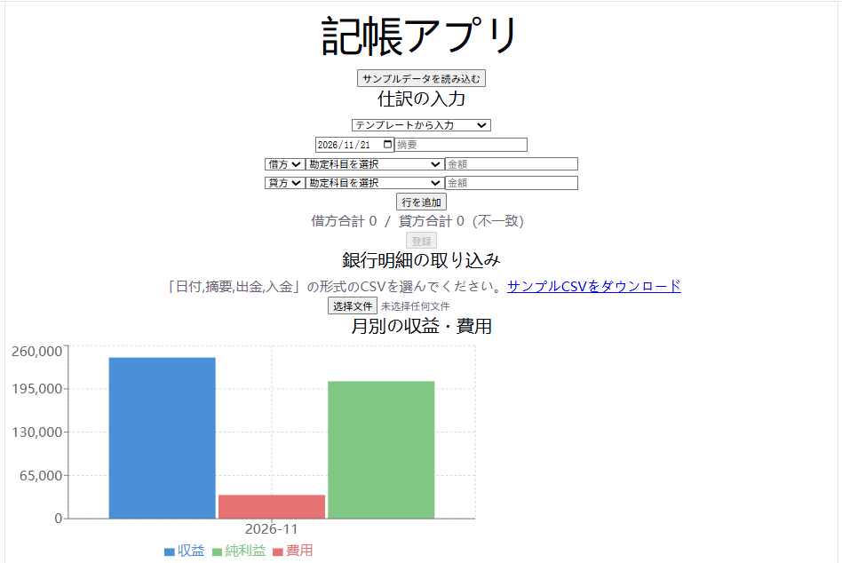
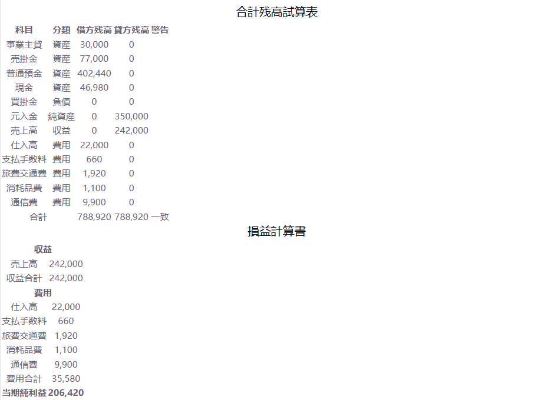

## はじめに

個人事業主向けの複式簿記アプリを個人開発しています。仕訳を入力すると、借方と貸方が合っているかを自動でチェックし、試算表や損益計算書まで作れるアプリです。

- デモ：https://ledger-frontend-5d86.onrender.com
- リポジトリ：https://github.com/ssei8643/ledger-api

:::message
デモは無料プランで公開しているため、初回アクセスは起動に1分ほどかかります。デモデータは定期的にリセットされます。また、ログイン機能がなく誰でも書き込めるので、個人情報は入力しないでください。
:::



作り始めたきっかけは、大学の会計の授業です。授業では、帳簿をめくりながら手作業で記帳し、貸借対照表までまとめる実習がありました。10人近いグループで取り組みましたが、まとめ終わるまでに1週間ほどかかりました。途中で貸借対照表の左右が合わなくなり、前に戻ってやり直したこともあります。

そのときに、こうした間違いをプログラムでチェックできないかと考えたのが始まりです。

作っているうちに、簿記には「こういうデータは存在してはいけない」というルールがはっきり決まっていることに気づきました。借方と貸方は必ず一致する、記帳したものは消さずに訂正する、などです。この記事では、そうした簿記のルールを、間違ったデータが入らない仕組みとしてどう実装したかを紹介します。

使った技術は次のとおりです。

- フロントエンド：TypeScript、React、Vite
- バックエンド：Python、FastAPI、SQLAlchemy、SQLite
- テスト：pytest

## 前提：仕訳とは

簿記では、1つの取引を「借方」と「貸方」の2つの側面に分けて記録します。これを仕訳といいます。たとえば、コピー用紙を現金1,100円で買った場合はこうなります。

| 借方 | 金額 | 貸方 | 金額 |
|---|---|---|---|
| 消耗品費 | 1,100 | 現金 | 1,100 |

どんな仕訳でも、借方の合計と貸方の合計は必ず一致します。これを貸借一致といいます。このアプリの設計は、ほとんどがこのルールから始まっています。

## 1. 仕訳を「本体」と「明細」に分けた

上の例のように、借方と貸方が1行ずつの仕訳を単一仕訳といいます。仕訳をデータベースに保存するとき、いちばん単純なのは、単一仕訳を前提に「借方科目・貸方科目・金額」を1行に持たせる形です。

ところが、この形では表せない仕訳があります。たとえば、売掛金11,000円が、振込手数料220円を差し引かれて入金された場合です。

| 借方 | 金額 | 貸方 | 金額 |
|---|---|---|---|
| 普通預金 | 10,780 | 売掛金 | 11,000 |
| 支払手数料 | 220 | | |

科目が3つあるので、1行には収まりません。このような仕訳を複合仕訳といいます。

そこで、仕訳を「本体」（日付と摘要）と「明細」（科目・借方か貸方か・金額）の2つのテーブルに分け、1つの仕訳が何行でも明細を持てるようにしました。

```python:main.py
class JournalEntry(Base):
    """仕訳本体"""
    __tablename__ = "journal_entries"

    id: Mapped[int] = mapped_column(primary_key=True)
    entry_date: Mapped[date] = mapped_column(Date)
    description: Mapped[str] = mapped_column(String(200))
    lines: Mapped[list["JournalLine"]] = relationship(back_populates="entry")


class JournalLine(Base):
    """仕訳明細"""
    __tablename__ = "journal_lines"

    id: Mapped[int] = mapped_column(primary_key=True)
    entry_id: Mapped[int] = mapped_column(ForeignKey("journal_entries.id"))
    account: Mapped[str] = mapped_column(
        String(50), ForeignKey("accounts.name")
    )
    # "debit"（借方）または "credit"（貸方）
    side: Mapped[str] = mapped_column(String(6))
    amount: Mapped[int]
    entry: Mapped[JournalEntry] = relationship(back_populates="lines")
```

（説明に関係ない列は省略しています）

なお、金額は円未満を扱わないので、誤差が出る `float` ではなく `int`（円単位の整数）で持っています。

## 2. 画面・API・データベースの各層でチェックする

貸借の一致は、このアプリでいちばん大事なルールです。そこで、画面からデータベースまでの各層でチェックしています。層ごとに目的が違います。

### 画面：入力する人がすぐ気づけるようにする

画面では、入力中の借方合計と貸方合計をリアルタイムで表示し、一致しないあいだは登録ボタンを押せないようにしました。

```tsx:JournalForm.tsx
const debitTotal = lines
  .filter((l) => l.side === "debit")
  .reduce((sum, l) => sum + l.amount, 0)
const creditTotal = lines
  .filter((l) => l.side === "credit")
  .reduce((sum, l) => sum + l.amount, 0)
const isBalanced = debitTotal > 0 && debitTotal === creditTotal
const allSelected = lines.every((l) => l.account !== "")

// ...

<button type="submit" disabled={!isBalanced || !allSelected}>
  登録
</button>
```

また、単一仕訳は借方と貸方が必ず同じ金額になるので、片方に金額を入れると、もう片方にも自動で入るようにしています。入力の手間を減らすための小さな工夫です。

### API：間違ったリクエストを受け付けない

実は最初は、画面だけでチェックしていました。ところが、画面を通さずにAPIを直接呼んでみると、借方と貸方が合わない仕訳もそのまま保存できてしまいました。画面のチェックは入力する人を助けるためのもので、データを守る役割は果たしていなかったのです。

そこでAPI側でも、Pydanticの `model_validator` で貸借の一致を確認するようにしました。

```python:main.py
class JournalLineIn(BaseModel):
    account: str
    side: Literal["debit", "credit"]
    amount: int = Field(gt=0)


class JournalEntryCreate(BaseModel):
    entry_date: date
    description: str
    lines: list[JournalLineIn] = Field(min_length=2)

    @model_validator(mode="after")
    def check_balanced(self):
        debit = sum(l.amount for l in self.lines if l.side == "debit")
        credit = sum(l.amount for l in self.lines if l.side == "credit")
        if debit != credit:
            raise ValueError(
                f"借方合計 {debit} と貸方合計 {credit} が一致しません"
            )
        return self
```

`model_validator(mode="after")` を使うと、各項目の型チェックが終わったあとに、モデル全体を見てチェックできます。貸借の一致は複数の明細にまたがるルールなので、ここに書くのが合っていると考えました。チェックに失敗すると、FastAPIが自動で422エラーを返します。

あわせて、明細が2行以上あること（`Field(min_length=2)`）と、各行の金額が0より大きいこと（`Field(gt=0)`）もAPI側で確認するようにしました。金額にマイナスを許すと、「借方のマイナス」が実質的に貸方と同じ意味になり、借方と貸方の区別があいまいになってしまうからです。

存在しない勘定科目（たとえば「現金」を「現全」と打ち間違えた場合）も、登録前に勘定科目マスタと照らし合わせて拒否しています。APIでは、どの科目が未登録なのかをエラーメッセージで返しています。

### 保存の直前：どの経路から保存しても貸借を確認する

記事のレビューで指摘してもらって気づいたのですが、ここまででは穴が残っていました。3章で紹介する取消のAPIと、銀行明細のCSV取り込みは、`JournalEntryCreate` を通さずに、コードの中で `JournalEntry` を直接組み立てています。今はどちらも、作り方の上で必ず貸借が一致します。しかし将来、保存する経路を増やしたときにチェックを書き忘れると、貸借の合わない仕訳が保存されてしまいます。

そこで、SQLAlchemyの `before_flush` イベントを使い、データベースに書き込む直前に、追加・変更されたすべての仕訳の貸借を確認するようにしました。ORMを通して保存する限り、どの経路からでも必ずこのチェックを通ります。

```python:main.py
def ensure_balanced(entry: JournalEntry) -> None:
    debit = sum(l.amount for l in entry.lines if l.side == "debit")
    credit = sum(l.amount for l in entry.lines if l.side == "credit")
    if len(entry.lines) < 2 or debit != credit:
        raise UnbalancedEntryError(
            "貸借が一致しない仕訳は保存できません"
            f"（借方 {debit}／貸方 {credit}）"
        )


@event.listens_for(Session, "before_flush")
def check_entries_before_flush(session, flush_context, instances):
    entries = set()
    for obj in list(session.new) + list(session.dirty):
        if isinstance(obj, JournalEntry):
            entries.add(obj)
        elif isinstance(obj, JournalLine) and obj.entry is not None:
            entries.add(obj.entry)
    for entry in entries:
        ensure_balanced(entry)
```

`session.new` と `session.dirty` には、これから追加・変更されるオブジェクトが入っています。仕訳本体だけでなく明細も見ているのは、既存の仕訳に明細だけが追加・変更された場合にも気づけるようにするためです。

このチェックに引っかかると、500エラーになります。普通の入力ならAPIの段階で422として弾かれるので、ここで止まるのはプログラムにバグがあるときだけです。間違ったデータが黙って保存されるより、エラーで止まるほうが安全だと考えました。

### データベース：最後の砦

さらに、データベースにもCHECK制約を付けました。

```python:main.py
class JournalLine(Base):
    __tablename__ = "journal_lines"
    __table_args__ = (
        CheckConstraint("amount > 0", name="ck_amount_positive"),
        CheckConstraint("side IN ('debit', 'credit')", name="ck_side"),
    )
```

また、明細の勘定科目には、勘定科目マスタへの外部キー制約を付けています。注意したいのは、SQLiteは外部キー制約を既定では検査しないことです。モデルに `ForeignKey` を書くだけでは効かないので、接続するたびに `PRAGMA foreign_keys=ON` を実行しています。

```python:main.py
@event.listens_for(Engine, "connect")
def enable_sqlite_foreign_keys(dbapi_connection, connection_record):
    # SQLiteは外部キー制約を既定では検査しないので、接続するたびに有効にする
    cursor = dbapi_connection.cursor()
    cursor.execute("PRAGMA foreign_keys=ON")
    cursor.close()
```

ただし、データベースで守れているのは、金額が正の数であること、借方・貸方の値、勘定科目が存在することだけです。いちばん大事な貸借の一致は、データベースでは守れていません。

貸借の一致は、同じ仕訳の明細をすべて足し合わせて比べる、複数の行にまたがるルールです。一方、SQLiteのCHECK制約は同じ行の値しか見られず、サブクエリも書けません（[SQLiteのドキュメント](https://www.sqlite.org/lang_createtable.html#ckconst)）。トリガーを使う方法も考えましたが、明細は1行ずつ追加されるので、追加の途中では必ず貸借が合わず、単純には書けません。そのため、貸借の一致は1つ前の「保存の直前」の層で守っています。

まとめると、チェックは次の4か所で行っています。

| 層 | 目的 | チェック内容 |
|---|---|---|
| 画面 | 入力する人がすぐ気づける | 貸借合計のリアルタイム表示、登録ボタンの無効化 |
| API（Pydantic） | 間違ったリクエストを受け付けない | 貸借の一致、2行以上、金額が正の数、未登録の科目 |
| 保存の直前（before_flush） | どの経路から保存しても守る | 貸借の一致、2行以上 |
| データベース（CHECK制約・外部キー） | 最後の砦 | 金額が正の数、借方・貸方の値、勘定科目の存在 |

## 3. 仕訳は修正・削除せず、訂正仕訳で直す

会計では、一度記帳した内容は消さずに、反対の仕訳を記帳して訂正するのが原則です。あとから「いつ、何を、なぜ直したのか」を確認できるようにするためです。

国税庁の「優良な電子帳簿の要件判定チェックシート」にも、データを直接訂正・削除できないシステムを使い、訂正・削除は当初のデータを特定する情報を付けた反対仕訳で行う、という方法が挙げられています（[チェックシート（PDF）](https://www.nta.go.jp/law/joho-zeikaishaku/sonota/jirei/pdf/0021011-060_03.pdf)）。このアプリが要件を満たしているわけではありませんが、設計の考え方として参考にしました。

そこで、仕訳を修正・削除するAPIはあえて作りませんでした。

### 訂正の流れ

たとえば、1,100円のコピー用紙を、間違えて1,000円で登録してしまった場合は、次のように直します。

1. 間違えた仕訳#1を取り消す。借方と貸方を入れ替えた取消仕訳#2が自動で作られる
2. 正しい内容で、仕訳#3を登録し直す

| 仕訳 | 摘要 | 借方 | 貸方 |
|---|---|---|---|
| #1 | コピー用紙購入 | 消耗品費 1,000 | 現金 1,000 |
| #2 | 【取消】仕訳#1：金額誤り | 現金 1,000 | 消耗品費 1,000 |
| #3 | コピー用紙購入 | 消耗品費 1,100 | 現金 1,100 |

#1と#2が打ち消し合うので、消耗品費の残高は正しい1,100円になります。それでいて、3件とも帳簿に残るので、あとから見ても何をどう直したのかがわかります。

### 取消のAPI

取消仕訳を作るAPIは次のとおりです。

```python:main.py
@app.post("/journal-entries/{entry_id}/reverse", status_code=201)
def reverse_journal_entry(
    entry_id: int, payload: ReverseRequest, db: Session = Depends(get_db)
):
    original = db.get(JournalEntry, entry_id)
    if original is None:
        raise HTTPException(status_code=404, detail="仕訳が見つかりません")
    if original.reverses_id is not None:
        raise HTTPException(
            status_code=422,
            detail="取消仕訳をさらに取り消すことはできません",
        )

    already = db.scalar(
        select(JournalEntry.id).where(JournalEntry.reverses_id == entry_id)
    )
    if already is not None:
        raise HTTPException(
            status_code=409,
            detail=f"この仕訳はすでに仕訳#{already}で取り消されています",
        )

    # 借方と貸方を入れ替えた仕訳を作る
    opposite = {"debit": "credit", "credit": "debit"}
    reversal = JournalEntry(
        entry_date=payload.entry_date,
        description=f"【取消】仕訳#{entry_id}：{payload.reason}",
        reverses_id=entry_id,
        lines=[
            JournalLine(
                account=l.account, side=opposite[l.side], amount=l.amount
            )
            for l in original.lines
        ],
    )
    db.add(reversal)
    db.commit()
    db.refresh(reversal)
    return reversal
```

（デコレーターの一部の引数は省略しています）

取消仕訳には、どの仕訳を取り消したのかを `reverses_id` として記録しています。これが、当初のデータを特定するための情報にあたります。これを使って、次の2つを防いでいます。

- 同じ仕訳を2回取り消すこと（409エラー）
- 取消仕訳をさらに取り消すこと（422エラー）

`reverses_id` にはデータベースの一意制約（`unique=True`）も付けているので、APIの確認をすり抜けたとしても、1つの仕訳に取消仕訳が2つできることはありません。

## 4. 「止める」ルールと「知らせる」ルールを分けた

簿記のルールには、破られたら絶対に間違いだと言えるものと、怪しいけれど間違いとは言い切れないものがあります。

たとえば、現金の残高がマイナス（貸方残高）になることは、普通はありえません。しかし、開始時の残高（期首残高）を入れ忘れているだけ、ということもあります。これを登録の時点で拒否してしまうと、入力の順番によっては正しい仕訳まで登録できなくなります。

そこで、貸借の不一致のような「絶対に間違い」のものは登録を止め、残高の向きがおかしいものは試算表で警告を出すだけにしました。期首残高を入れずに現金で支払う仕訳だけを登録すると、試算表の現金の行に警告が出ます。そのあと開始仕訳を登録すると、警告は消えます。


*試算表の右端に「警告」列があります（サンプルデータでは警告は出ていません）*

### 科目ごとに「残高の向き」を持たせる

最初は、勘定科目の分類（資産・負債など）だけで、残高が本来どちら側に出るかを決めていました。ところが、これでは困る科目があります。

減価償却累計額（間接法）や貸倒引当金は、分類としては資産ですが、資産の価値を減らす「評価勘定」なので、残高は貸方に出ます。分類だけで判定すると、これらの科目にはいつも警告が出てしまいます。

そこで、勘定科目マスタに `normal_side`（残高が本来どちら側に出るか）を持たせました。分類の値を既定値として使い、評価勘定のような例外だけ、科目ごとに上書きします。

```python:main.py
CATEGORY_NORMAL_SIDE = {
    "資産": "debit",
    "負債": "credit",
    "純資産": "credit",
    "収益": "credit",
    "費用": "debit",
}

DEFAULT_ACCOUNTS = [
    ("現金", "資産"),
    ("普通預金", "資産"),
    # ...（省略）
    # 評価勘定：分類は資産だが、残高は貸方に出る
    ("減価償却累計額", "資産", "credit"),
    ("貸倒引当金", "資産", "credit"),
]


def seed_accounts(db: Session) -> None:
    existing = set(db.scalars(select(Account.name)))
    for name, category, *override in DEFAULT_ACCOUNTS:
        if name not in existing:
            normal_side = (
                override[0] if override else CATEGORY_NORMAL_SIDE[category]
            )
            db.add(
                Account(name=name, category=category, normal_side=normal_side)
            )
    db.commit()
```

試算表を作るときは、この科目ごとの向きと逆側に残高が出ていれば警告を付けます。

```python:main.py
diff = debit - credit

# 本来と逆側に残高が出ていれば警告（科目ごとの残高の向きで判定）
warning = None
if normal_side == "debit" and diff < 0:
    warning = f"{category}の科目が貸方残高になっています"
elif normal_side == "credit" and diff > 0:
    warning = f"{category}の科目が借方残高になっています"
```

一方、貸借対照表では、評価勘定も分類（資産）に従って集計します。減価償却累計額はマイナスの金額になり、資産の合計から差し引かれます。「どの分類に属するか」と「残高がどちら側に出るか」は別の情報だ、というのがこの修正での学びでした。

なお、個人事業主に特有の事業主貸・事業主借は、このアプリでは事業主貸を資産、事業主借を純資産に分類しています。どちらも分類の既定値と実際の残高の向きが一致するので、上書きは必要ありません。

## 5. テストを「仕様書」として書いた

ここまでのルールは、すべてpytestのテストにしています（全32件）。テストの名前は日本語にしました。

```python:test_main.py
def test_貸借が一致しない仕訳は拒否され保存もされない(client):
    bad = {**SIMPLE_ENTRY, "lines": [
        {"account": "消耗品費", "side": "debit", "amount": 1100},
        {"account": "現金", "side": "credit", "amount": 1000},
    ]}
    res = client.post("/journal-entries", json=bad)
    assert res.status_code == 422
    assert client.get("/journal-entries").json() == []
```

テストの一覧を見るだけで、アプリが守っているルールがわかるようにしたかったからです。

```text
test_貸借が一致する仕訳は登録できる
test_複合仕訳を登録できる
test_貸借が一致しない仕訳は拒否され保存もされない
test_APIを通らない経路でも貸借が一致しない仕訳は保存されない
test_未登録の勘定科目は拒否され保存もされない
test_APIを通らない経路でも未登録の勘定科目は保存されない
test_期首残高がないと資産の貸方残高に警告が出る
test_開始仕訳を登録すると警告が消える
test_減価償却累計額は貸方残高でも警告が出ない
test_仕訳を取り消すと貸借が逆の仕訳が作られる
test_同じ仕訳は二重に取り消せない
test_取消仕訳はさらに取り消せない
...
```

エラーが返ることだけでなく、「保存もされない」ことまで確認しているのがポイントです。422が返っていても、データが途中まで保存されていたら意味がないからです。このテストは、前に気づいた「画面を通さなければ間違った仕訳を保存できてしまう」問題が、二度と起きないことを確かめるためのものでもあります。保存直前のチェックと外部キーについても、APIを通さずに `JournalEntry` を直接作って保存しようとすると、それぞれ `UnbalancedEntryError` と `IntegrityError` になることを確認しています。

テストでは、毎回まっさらなメモリ上のSQLiteを使っています。FastAPIの `dependency_overrides` で、本番用のデータベース接続をテスト用のものに差し替えています。

```python:test_main.py
@pytest.fixture
def client():
    test_engine = create_engine(
        "sqlite://",
        connect_args={"check_same_thread": False},
        poolclass=StaticPool,
    )
    Base.metadata.create_all(test_engine)
    TestSession = sessionmaker(bind=test_engine)
    with TestSession() as db:
        seed_accounts(db)

    def override_get_db():
        with TestSession() as db:
            yield db

    app.dependency_overrides[get_db] = override_get_db
    with TestClient(app) as c:
        yield c
    app.dependency_overrides.clear()
```

メモリ上のSQLiteは、接続ごとに別々のデータベースになってしまいます。`StaticPool` を指定して1つの接続を使い回すことで、テーブル作成とAPIの呼び出しが同じデータベースを見るようにしています。

## 今の設計の限界

ここまで紹介した仕組みにも、まだ足りないところがあります。

- **貸借の一致はデータベースでは守れていない**：ORMを通さずにSQLを直接実行すると、保存直前のチェックも通りません。
- **マイグレーションの仕組みがない**：テーブルに列を追加すると、データベースを作り直す必要があります。
- **取消は画面から操作できない**：取消のAPIはありますが、画面にはまだボタンがありません。
- **年度の区切りと消費税に対応していない**：決算整理や年度をまたいだ繰越はできず、消費税も扱っていません。
- **デモ環境は誰でも書き込める**：ログイン機能がないので、公開中のデモには誰でも仕訳を登録できます。

## 生成AIの使い方

設計の相談やコードの作成には、Claude（生成AI）を使いました。提案されたコードは画面で動かして確認し、テストを書いてから取り入れるようにしています。

複数の方法が考えられるときは、どれを選ぶかを自分で決めました。ここでは、AIの提案を採用しなかった例を2つ紹介します。

### 銀行明細の取り込み：プレビュー結果をサーバーに保存しない

銀行明細のCSV取り込みでは、まずプレビューを表示し、人が勘定科目を確認してから登録します。

- **AIの案**：プレビューの結果をサーバーに保存しておき、登録時にはそれを使う
- **選んだ方法**：画面から送り返されたデータで登録し、登録時にサーバーでもう一度チェックする

AIの案だと、テーブルを1つ増やすか、セッションの管理が必要になり、コードがかなり複雑になります。一方、このアプリは自分の帳簿を自分で登録するためのものなので、送り返されたデータが改ざんされても、影響はその本人の帳簿の中に閉じます。

それでも、勘定科目が存在するか、すでに取り込み済みの明細ではないかは、登録時に確認しています。仕訳の借方・貸方もサーバー側で組み立てるので、送られたデータによって貸借が崩れることはありません。ただし、入力する人と確認する人が別になるような使い方をするなら、この判断は見直す必要があると考えています。

### 年度ごとの損益計算書：今回は作らない

- **AIの案**：年度を分けて損益計算書を集計する
- **選んだ方法**：今回は見送り、仕訳の入力から財務諸表の表示までの流れを一通り動かすことを優先する

年度をまたぐには、決算整理や、当期純利益を翌年度に振り替える処理が必要で、会計の面でもかなり複雑になるからです。

## おわりに

簿記のルールは、そのまま「間違ったデータを入れない仕組み」として設計に落とし込めることがわかりました。特に、「止めるルール」と「知らせるルール」を分けることや、「分類」と「残高の向き」を別の情報として持つことは、会計の知識がそのまま設計に生きた点だと思います。

今後は、次のことに取り組む予定です。

- 総勘定元帳と、取消操作の画面
- 年度・期間を指定した財務諸表と、決算整理
- マイグレーションの仕組み（Alembicなど）の導入
- 消費税の扱い
- エラー時の部分表示（Error Boundary）
- ログイン機能と、事業者ごとのデータの分離

最後まで読んでいただき、ありがとうございました。
